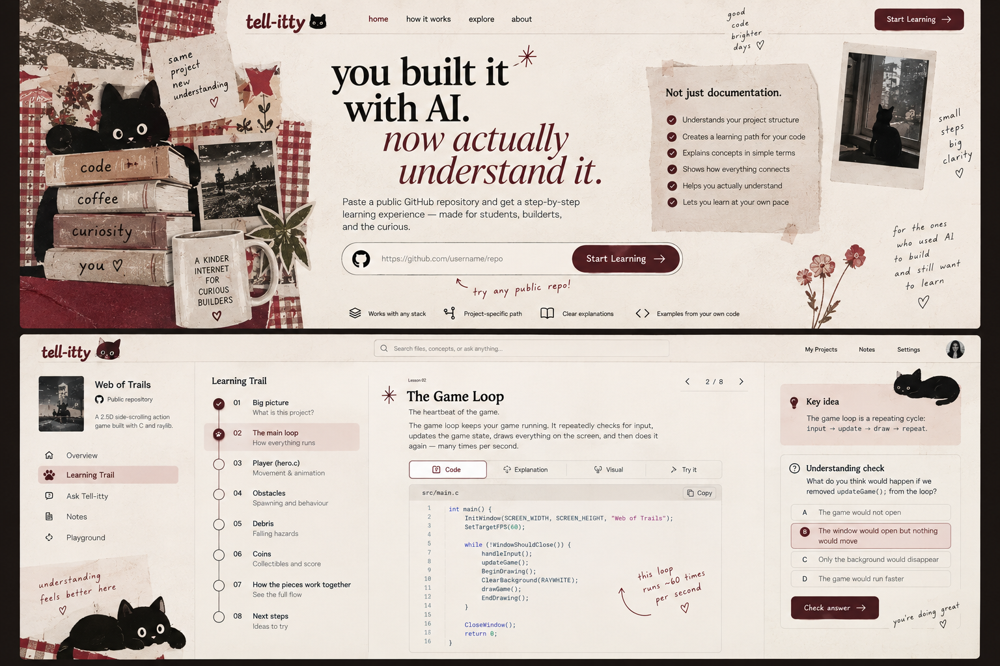

# Tell-itty — Design System

## Reference image
**Use `./design-reference.png` as the primary visual reference for the desktop implementation.**

The implementation should capture the reference's visual language, not reproduce every decorative object literally. When this file and generic framework defaults disagree, follow this file/reference.

## Design thesis
Tell-itty should feel like a **clever student's annotated notebook / vintage editorial scrapbook translated into a usable code-learning product**.

It must have personality without sacrificing clarity. The interface is not a moodboard: the learner's repository and current lesson remain the center of attention.

Keywords:
**textured paper · deep maroon · ink black · warm cream · black cats · editorial · playful type · collage accents · tactile · curious · student-made in the best sense**

Avoid:
**generic AI SaaS · purple/blue gradients · glassmorphism · giant glowing cards · robot icons · sparkle overload · sterile corporate dashboard · excessive rounded pills · dense three-column information walls**

## Palette
Use a restrained palette with strong contrast:
- Paper: warm textured off-white / cream (`#F4EFE6` family)
- Ink: near-black (`#171411` family)
- Deep maroon: primary accent (`#6E1823` / `#741E29` family)
- Secondary paper/tape: muted beige (`#D8C8B6` family)
- Optional tiny secondary accent: dusty muted red/pink, only where useful

Do not introduce additional saturated colors unless required by code syntax or accessibility states.

## Texture
The background should not be flat pure white. Create subtle paper grain using a lightweight CSS texture/noise technique, a tiny local texture asset, or layered gradients with very low contrast.

Texture must never reduce text/code readability.

## Cats
Black cats are the signature motif.

Important: **cats should look like simple graphic/sticker/illustrated cats, not pencil sketches.** Think printed collage character, bold silhouette, round expressive eyes, slightly quirky proportions.

Use them at a few memorable moments:
- small brand cat near logo
- one landing-page hero cat/collage
- tiny cat marking current progress or resting near a lesson edge
- occasional empty/loading/error state

Do not place a cat inside every card/button.

## Typography
Typography should be playful but still excellent for reading.

Use three roles maximum:
1. **Display/editorial font** — expressive serif or chunky editorial face for hero statements and lesson titles.
2. **Friendly sans** — clean, slightly characterful body/UI font.
3. **Monospace** — code only.

The logo `tell-itty` can be custom-styled with a playful rounded/heavy face and maroon color.

Use italics selectively for emphasis such as “now actually understand it.” Handwritten-looking type may appear only in tiny annotation notes; never use it for important UI labels or body paragraphs.

## Layout principle
**One primary thought per viewport.**

The earlier design was too information-dense. Do not show the entire curriculum, full explanation, diagram, quiz, notes and navigation with equal visual weight simultaneously.

Use progressive disclosure.

---

# Screen 1 — Landing
Desktop should feel spacious and authored.

### Header
Left: `tell-itty` + small black cat mark.
Right: at most `how it works` and optional `about`. Avoid unnecessary navigation.

### Hero
Large statement:
**you built it with AI.**
*now actually understand it.*

Short supporting sentence, max two lines:
**Paste a public GitHub repository. Tell-itty finds the learning trail through your project and teaches it one step at a time.**

### Repository input
This is the strongest interactive object on the page.
- Large horizontal field
- GitHub icon on left
- placeholder: `https://github.com/username/repo`
- obvious maroon button on right: **Start Learning →**
- visible hover/focus state
- pressing Enter should also submit

Helper beneath:
`public repositories only · no sign-up needed`

### Art direction
Use collage/cat decoration mostly around the perimeter so the center remains readable. Maroon gingham/tape/paper fragments are welcome in moderation. One large graphic black cat can make the landing memorable.

Do not put a feature checklist beside the hero in the final one-hour version unless there is clearly spare space. Simpler is stronger.

---

# Screen 2 — “We found your trail”
This screen is essential even if the reference combines it with the lesson. It proves Tell-itty has understood the repo before teaching.

### Top
Small project identity:
- repository/project name
- one-sentence summary
- detected stack as quiet text, not a pile of badges

Headline:
**Tell-itty found your learning trail.**

Subcopy:
`We'll start with the mental model, then follow how the important pieces connect.`

### Trail
Use a generous vertical or gently winding path through 5–9 lessons.

Each step has:
- number
- concept title
- one short learning goal
- state: complete/current/upcoming

The black cat can sit/walk beside the current step.

The whole step should be clickable, with obvious hover treatment. Current step can use a pale maroon paper block. Do not hide clickability behind tiny icons.

Primary action at bottom/right:
**Start with 01 →**

No quiz, full code or long explanation on this screen.

---

# Screen 3 — Lesson
A lesson should feel like turning to one clean page of a notebook.

### Header/breadcrumb
`Web of Trails / 02 of 08`

Small Previous/Next arrows are okay, but the main Next button should also appear after the learning content.

### Above the fold
Show only:
- lesson number
- title
- short subtitle
- “why this matters” in 1–2 sentences
- one key mental model

Example:
**02. The Game Loop**
`The heartbeat of this game.`

### Learning stages
Instead of placing everything beside everything, reveal content in a clear vertical sequence:

**1 — See it**
Relevant real code excerpt with path and Copy button.

**2 — Make sense of it**
2–5 short explanation steps and, where useful, a tiny flow visual.

**3 — Connect it**
A small relation such as:
`main.c → UpdateHero() → hero.c`
Explain why that connection matters.

**4 — Check yourself**
One reasoning question.

**5 — Try it**
One tiny change/investigation.

These can be sections or a simple tab/step control, but the interaction must be obvious. If tabs are used, use words plus clear selected states — not ambiguous icons alone.

### Code block
- warm/light code canvas
- file path visible
- readable monospace
- horizontal scroll if necessary
- syntax color should remain subtle
- Copy is a familiar outlined button with icon + word

### Understanding check
Question in a distinct but quiet paper panel.
Answers are large full-width clickable rows with radio/check affordance.
Selected answer gets obvious border/background change.
Primary maroon button: **Check answer →**
After check, show concise explanation.

### Next action
Large and explicit:
**Next: How player movement works →**

Never rely only on a chevron icon for navigation.

---

## Buttons and clickability
Every interactive element must look interactive without guessing.

### Primary
Deep maroon filled button, cream/white text, clear label, optional arrow.
Examples:
- `Start Learning →`
- `Check answer →`
- `Next: State & data →`

### Secondary
Cream/transparent with ink border.
Examples:
- `← Previous`
- `Explain deeper`

### Clickable trail step
Large target area, subtle border/paper block, hover movement or background change, cursor pointer.

Avoid icon-only actions except universally understood menu/copy controls, and even Copy should preferably include its text label.

## Spacing
Err on the side of more whitespace.
- Hero max text width ~650–760px.
- Body reading width ~650–800px.
- Use large section gaps.
- Do not fill empty space simply because it exists.

## Motion
If time permits only:
- 150–250ms button/hover transitions
- gentle trail-step reveal
- subtle cat movement during analysis

No elaborate page transitions before functionality is complete.

## Analysis/loading state
Keep the same paper canvas. Center a black cat and cycle concise status text:
`reading the repo…`
`finding the entry points…`
`tracing how the pieces connect…`
`building your learning trail…`

No fake percentage.

## Error state
Friendly but direct:
**We couldn't read that repository.**
Then the actual reason when known, plus **Try another repo**.

A cat can appear here, but the error message must remain the focus.

## Accessibility / usability
- Strong text contrast.
- Visible keyboard focus.
- Minimum comfortable click targets.
- Never encode progress solely by color.
- Code must remain selectable.
- Decorative texture/collage should be ignored by screen readers.

## Final anti-slop check
Before considering the UI done, remove anything that looks like it was added merely because an AI dashboard “should” have it.

Ask:
- Does this element help the student understand their project?
- Does it strengthen Tell-itty's authored identity?
- Is the next action obvious?

If all three answers are no, delete it.
